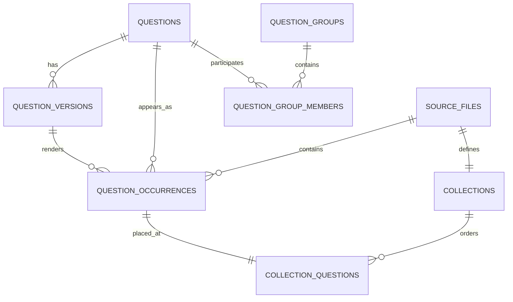

# 数据与索引架构

## 目标

数据设计同时满足：

1. 能从原始 Excel/Word 完整重建；
2. 能按原文件路径和原题号精确刷题；
3. 能跨文件去重并快速搜题；
4. 能保留来源答案冲突；
5. 能在 4 核 4G 服务器上稳定运行；
6. catalog、向量和用户状态互相独立。

## 数据分层

```text
data/                            原始只读输入
  <考试>/<组织方式>/<学科>/<文件>

knowledge-base/
  current.json                  当前 catalog 指针
  builds/<catalog_id>/
    catalog.sqlite3             只读题库与 FTS
    manifest.json               来源哈希、统计和构建信息
    import-report.json          导入报告
    conflict-report.json        来源冲突报告
  vector-current.json           当前向量指针
  vector-indexes/<vector_id>/
    embeddings.npy              float32 归一化矩阵
    question_ids.json           行号到 question_id
    manifest.json               catalog/模型/维度/哈希
    build-state.json            可恢复构建进度

state/
  app.sqlite3                   账号、资料隐私、头像、会话、文件刷题状态、收藏、错题、私有笔记、评论、关注、反应、通知、私信、AI 会话消息、论坛主题回复与审核审计；个人导出只读这些账号状态
  import-staging/               管理员通用题库导入预检源文件与 manifest；不进入 catalog 或 Git
  settings.sqlite3              网站与模型设置
  settings.key                  设置加密密钥
  vector-operation.json         管理员向量构建/删除后台任务状态
```

原始数据、派生制品和运行状态均不进入 Git。

## 实体关系



### 规范题 `questions`

用于去重、关键词检索、语义向量和跨来源统计。题干及选项归一化后生成稳定 fingerprint。同一道题出现在多个文件时只构建一个向量。

### 内容版本 `question_versions`

保留每个来源文件中的题干、选项、答案、考点和解析。出现答案或内容冲突时不覆盖来源，而是保留多个内容版本并写入冲突报告。

### 原题记录 `question_occurrences`

连接规范题、内容版本和源文件，保存工作表、行号和原位置。文件刷题必须由 occurrence 读取内容版本和答案。

### 文件题集 `collections`

一个物理文件对应一个 collection，完整相对路径包含扩展名并保持唯一。同名 `.xlsx` 与 `.docx` 不能合并。

### 病例题组

`question_groups` 保存 A3/A4 共享病例题干，`question_group_members` 保存子题顺序和子题干。搜索结果可展示题组关系，但向量仍按子题构建，绝不跨题拼成一个 chunk。

## 固定排序

目录排序由 `medical_app/ordering.py` 决定：

- 顶层考试按学习与使用顺序；
- 306 学科为生理学、病理学、内科学、外科学、生物化学、人文精神；
- 人体系统使用显式医学顺序；
- 中文篇章和括号序号按数值；
- 历年真题按年份从新到旧；
- 未命中显式规则的条目稳定排在已知条目之后。

禁止把操作系统、SQLite 或普通字符串排序直接暴露为题库顺序。

`/api/library/tree` 从 catalog 内存目录缓存生成指定父路径下的只读嵌套子树，目录与文件的每一层仍调用同一医学排序规则。前端分类导航的考试与题库类型使用固定宽度、自动换行的多行标签，每组可独立展开或收起且手机端不使用横向滑动；只有用户展开某个学科时才请求对应子树，避免一次传输全部 2,127 个文件。异步切换标签或展开目录时保留原内容直至新数据就绪，并恢复用户当前滚动位置，不能因临时加载占位导致页面跳回顶部。树节点继续保留完整相对路径、collection ID、题数和文件扩展名。题库顶层路径固定使用“专硕考研、学硕考研、执业医师、三基考试”，不附加括号内的考试说明。

## Catalog 构建

```powershell
python scripts\build_catalog.py --activate
```

构建过程：

1. 只读扫描 `data/`；
2. 记录相对路径、扩展名、大小和 SHA-256；
3. 解析 Excel/Word 并标准化题型、题干、选项和答案；
4. 生成规范题、来源版本、occurrence 和 collection；
5. 识别病例题组；
6. 构建 FTS5；
7. 输出导入与冲突报告；
8. 执行完整性、外键和统计校验；
9. 写入不可变 build；
10. `--activate` 原子更新 `current.json`。

任何失败都不能覆盖已激活 build。

## 搜索索引

### FTS5

FTS 记录与规范题一一对应，包含题干、选项、考点和解析，用于题号、精确片段和关键词召回。中文片段使用 trigram 召回，拉丁字母、希腊字母与数字医学术语保持完整检索，避免不存在的编号被拆成数字片段后误召回无关题目。返回结果再通过结构化表恢复来源路径和 occurrence。

搜题 API 的 `search_fields` 支持 `stem`、`answer`、`point`、`explanation`，`question_types` 支持多个 catalog 实际来源题型标签。题型标签由 `raw_type` 与规范化显示规则共同生成，搜索与结果徽标共用同一标签；后端按规范化 raw type 精确过滤，不会把 A1/A2 等细分题型误归入仅勾选的普通题型。空题型数组表示不限制。题干、考点和解析通过 FTS5 列范围检索，答案通过结构化 `questions.answer` 检索；至少选择一个字段。语义向量只包含题型、题干和有序选项，因此 semantic / hybrid 必须包含 `stem` 范围，其他范围只参与 hybrid 的关键词召回。

### 语义向量

```text
单位：一道规范题
文本：题型 + 题干 + 有序选项
排除：答案 + 考点 + 解析
模型：Qwen/Qwen3-Embedding-0.6B
维度：1024
格式：float32 单位向量
```

64,078 × 1024 的矩阵约 250 MiB。生产通过 NumPy mmap 加载并由操作系统页缓存共享，不部署独立向量服务。查询使用归一化点积，hybrid 通过 RRF 融合关键词与语义候选。

向量 manifest 必须同时匹配：

- 当前 catalog ID；
- 规范题 ID 哈希与行数；
- API URL；
- 模型；
- 维度；
- 矩阵文件哈希、有限值和单位范数。

不兼容时 semantic/hybrid 明确不可用，keyword 继续工作。

## 用户状态

`state/app.sqlite3` 包含：

- `users` 与登录会话；
- `practice_sessions`；
- `practice_session_questions`；
- `question_progress`；
- `collection_question_progress` 文件维度刷题状态投影；
- `study_goals` 当前账号每日题数与学习时长目标；
- `study_items` 收藏和错题。
- `question_comments` 原题评论。

catalog 不写入用户状态。用户状态通过 `user_id` 隔离；收藏和错题保存 occurrence、collection 和相对路径，从而按原题库目录浏览。

收藏切换以 `(profile_id, kind, item_key)` 唯一键为事实源，重复操作不能生成重复记录。删除收藏或错题只修改当前账号的 `study_items`，不修改题库、历史答题记录或其他账号数据。密码修改与管理员密码重置会删除该用户的全部登录会话。

前端将错题、收藏、笔记、评论和点赞视为同一组个人学习页面，但五个入口只在题库顶部呈现，二级页不再重复五项导航。题库返回目标写入二级页 hash；从个人内容进入原题时再把完整列表 hash 写入会话地址，使刷新后的显式返回仍按“原题 → 列表 → 题库”恢复。评论、笔记和点赞 feed 使用 `limit + offset` 分批读取；任何收藏、错题、笔记、评论或赞同增删都会使前端今日统计缓存失效。

`collection_question_progress` 以 `(profile_id, collection_id, occurrence_id)` 唯一定位题号目录状态。提交答案时同步更新该投影；点击题库重置只删除当前账号在当前 collection 的投影行。`practice_sessions` 和 `practice_session_questions` 仍保留为历史试卷，`question_progress`、`study_items` 和 `question_comments` 均不随文件重置删除。同一道规范题出现在其他文件时也不会被连带重置。

练习记录不新增重复表。`practice_sessions.archived_at` 通过兼容迁移新增，空值表示正常展示，时间值表示当前账号已归档；归档不改变 `status`、`completed_at`、答案或任何进度投影，可通过幂等 API 恢复。`PracticeStore.session_history()` 直接聚合当前 `profile_id` 的 `practice_sessions` 与 `practice_session_questions`，默认排除归档，以 `active/complete/archived + limit + offset` 返回摘要、四类状态统计和 `has_more`；同秒活动使用插入顺序稳定排序。进行中的 `test` 会话在归档前后都只暴露总题数、已答数和进度，成绩字段为空；归档活动会话拒绝提交和交卷，collection 续答入口忽略归档记录。前端历史 hash 保存当前筛选，恢复会话后仍能返回同一历史列表；不提供删除历史的写接口。

`question_comments` 绑定具体 `occurrence_id`，同时保存 `question_id`、作者账号 ID、作者名快照、正文和时间。评论不写入 catalog、不依赖用户外键；所有登录用户可查看和发表，只有作者本人或管理员可以删除，正文去除首尾空白且最长 2000 字。

运行状态补充实体：`user_avatars` 以 `user_id` 保存服务端重编码后的 512×512 WebP；`question_notes` 以 `(profile_id, occurrence_id)` 唯一保存个人笔记；头像、笔记和评论均属于 state，不写入 catalog 或任何检索索引。笔记正文最长 10000 字，支持更新和删除，个人笔记列表通过 occurrence 反查原文件路径和题号。

社区状态补充实体：`comment_reactions` 以 `(comment_id, profile_id)` 保存赞同或反对；`question_comments.parent_comment_id` 保存回复关系；`user_follows` 保存单向关注与粉丝关系；`direct_messages` 保存账号间私信；`notifications` 保存系统通知、回复和收到赞同。五类数据都只在本地 state 中按账号隔离，评论正文仍不进入 FTS 或向量文本。`users` 的 birthday/gender/school/major/ip_location 与 `privacy_json` 用于公开个人资料和字段可见控制，`notification_json` 保存系统、私信、回复与@、赞同四类顶部提醒开关。粉丝/关注列表按 `user_follows.created_at` 分批读取，搜索只匹配用户名；学校与专业仍逐用户执行隐私过滤，列表点击后复用公开个人资料页。关闭粉丝或关注公开性会同时隐藏对应统计并拒绝关系列表读取；关闭私信会在写入前由服务端拒绝。通知开关仅影响 `/api/messages/alerts` 触发的前端短时提示，消息记录仍完整保留。

AI 状态补充实体：`ai_conversations` 以 `(conversation_id, profile_id)` 保存标题和更新时间，`ai_messages` 保存 user/assistant 内容、引用 JSON 与用户消息的 `context_json`。所有查询都带当前 profile 条件，删除会话通过外键级联删除消息；最多将 6 条题库检索结果拼入一次非流式 LLM 请求，引用只保存题目 ID、occurrence 和来源路径，不复制私有笔记或私信。回答复制和继续追问草稿只发生在浏览器；重新生成读取最后一对 user/assistant 消息和保存的上下文，原位替换 assistant 内容并以旧内容/引用做并发保护；等待中的请求使用 AbortController，取消后前端丢弃未完成响应。

论坛状态补充实体：`forum_sections` 保存本地分区，`forum_topics` 保存作者快照、标题、正文和 `open/hidden/deleted` 状态，`forum_replies` 保存楼层回复、可选父回复和 `visible/hidden/deleted` 状态，`forum_reactions` 以 `(target_type, target_id, profile_id)` 保存赞同/反对唯一状态。`parent_reply_id` 只能指向同主题内仍可见的回复，详情通过父回复作者快照返回 `parent_author_name`。列表按分区/关键词/最后活动分页，删除使用软删除状态；任何更新、删除都由服务端验证当前作者或管理员角色，已删除或隐藏内容不可再次编辑或互动，作者本人不能给自己的内容表态。`forum_moderation_log` 是只追加审核记录，保存目标、主题、管理员快照、动作、前后状态、原因和时间；管理员审核状态转换使用 `BEGIN IMMEDIATE`，恢复回复前验证所属主题公开，既有管理员跨作者编辑/删除也自动留痕。回复通知复用 `notifications(kind='reply')`，楼主与父回复作者去重后写入；回复正文按账号用户名规则最多解析 20 个唯一 `@用户名`，只向有效账号写入 `kind='mention'`，并排除作者自己以及已经收到本次回复通知的账号。首次切换为赞同时复用 `kind='agree'`，相同状态重复提交不重复通知。公开个人资料的动态在读取时合并题目评论、可见论坛主题和可见论坛回复，获赞统计合并非本人给予的评论与论坛赞同。

题库导出不创建新的事实源或状态表。`medical_app.catalog_export` 通过 SQLite `mode=ro` 与 `query_only` 读取当前激活 catalog，按 `collection_questions → question_occurrences → question_versions` 输出原题版本，并携带 collection 路径及位置。JSONL 使用结构化 `options`，CSV 使用 A–H 平铺列并中和电子表格公式前缀；生成器逐行读取，响应不缓存、不经 Nginx 缓冲，也不读取 `state/`。

个人学习数据导出不创建新表。`medical_app.study_export` 通过 SQLite `mode=ro` 与 `query_only` 读取 `study_goals`、`study_items`、`question_notes`、`question_progress`、`collection_question_progress`、`practice_sessions` 和 `practice_session_questions`，每条查询都绑定当前会话的 `profile_id`。JSONL 以 `record_type` 区分学习目标、收藏/错题、笔记、进度、文件进度、会话和逐题作答，会话记录包含 `archived_at`；CSV 使用固定列并中和公式前缀。生成器逐行输出并返回 `private, no-store` 与 `X-Accel-Buffering: no`，不读取 catalog、设置密钥或其他账号状态。

导入预检由 `medical_app.catalog_import` 管理权限固定为 `0700` 的 `state/import-staging/imp_*/`。目录内只保存随机命名的 `source.csv|jsonl|json` 和原子写入的 `manifest.json`；manifest 记录安全文件名、哈希、大小、字段、映射、行数、有限错误摘要与最多 10 条标准化样例。CSV/JSONL 逐行读取，JSON 受 16 MB 硬上限约束；任何预检都不调用 builder、不写 catalog、不改变激活指针或向量。后续正式导入必须从 staging 构建新的不可变 catalog 并在完整性检查后原子激活。

题库页的紧凑今日统计通过 `/api/study/today-summary` 从当前账号的会话、答题、收藏、错题、笔记、评论和赞同记录实时聚合；“今日”由上海自然日转换出的 UTC 半开区间定义，避免 UTC 凌晨边界错算。`study_goals` 以 `profile_id` 为主键保存每日题数（1–1000）和学习时长（1–1440 分钟），默认 20 题/30 分钟；汇总同时返回目标进度、连续学习天数和包含空白日期的近 7 日趋势。目录模式的所有文件夹层级和分类模式共用同一顶部统计与五个入口。更新时间紧邻标题右侧，分类导航只保留标题和分类数量。管理员运行概览继续从 catalog 读取全库统计，普通题库页面不会展示 64,078 等全局数字。

管理员构建通过 `medical_app.vector_task` 独立进程执行，`state/vector-operation.json` 记录 queued/running/complete/failed 与已完成数量。相同 API URL、模型、维度和文本版本的旧 manifest 可作为增量源；按 `question_id` 复制未变化行，只有新增或变化题目进入上游批次。删除向量只处理 `vector-current.json` 和 `vector-indexes/`，catalog、原始数据与用户 state 永不删除。

## 四种刷题模式

| 模式 | 作答 | 即时反馈 | 自动切题 | 交卷前答案 |
| --- | --- | --- | --- | --- |
| 练习 | 选择后手动提交 | 当前题 | 否 | 隐藏 |
| 快刷 | 选择后自动提交 | 正确自动前进，错误展开解析 | 选对时 | 当前已答题可见 |
| 测试 | 选择后自动提交 | 无 | 是 | 服务端隐藏 |
| 背题 | 无需作答 | 全部答案解析 | 手动/滑动 | 直接可见 |

测试模式处于 active 时，即使题目已经提交，API 也只能返回用户答案和已答状态，不返回 `is_correct`、正确答案、考点、解析和正确/错误计数。会话完成后才解锁整卷结果。

上一题、下一题、题号跳转和手机左右滑动共用同一前端导航规则。未提交时允许离开当前题并保留本地草稿，但不得写入答题记录或改变题号目录的已答状态。

## 真实数据验收基线

- source/collection：2,127；
- occurrences：123,564；
- questions/FTS：64,078；
- content versions：67,650；
- groups：1,443；
- group members：3,732；
- conflicts：4；
- SQLite integrity：`ok`；
- foreign key errors：0。

还必须抽查 `专硕考研/历年真题/2026/2026.xlsx`：165 题、A1/A2/A3-A4/B/X 题型目录、指定题号起始、原 occurrence 判分和四种模式。

## 用户反馈数据

`state/app.sqlite3` 中的 `user_feedback` 是独立的账号反馈表，不进入 catalog、FTS、向量或公共动态。每行包含不可预测的 `feedback_id`、`profile_id`、`category`、`body`、`status` 以及创建/更新时间；`category` 仅允许 `bug`、`suggestion`、`content`、`other`，`status` 仅允许 `open`、`resolved`，正文限制 2–4000 字。管理员查询通过状态/更新时间和账号/创建时间索引分页，账号删除后列表显示“已注销用户”而不丢失反馈记录。
