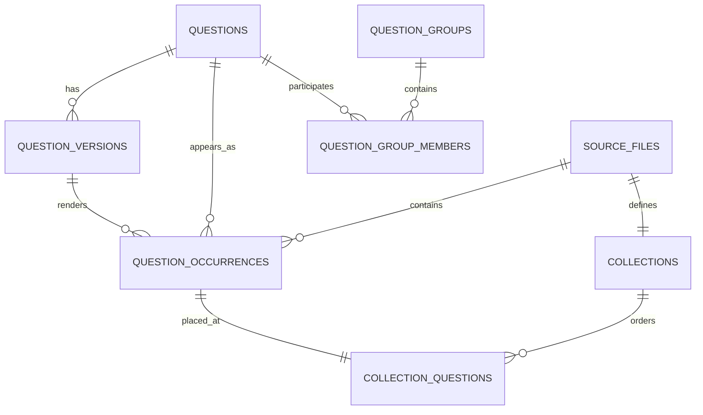

# 数据与索引架构

## 目标

数据设计同时满足：

1. 能从原始 Excel/Word 完整重建；
2. 能按原文件路径和原题号精确刷题；
3. 能跨文件去重并快速搜题；
4. 能保留来源答案冲突；
5. 能在 4 核 4G 服务器上稳定运行；
6. catalog、向量和用户状态互相独立。

## 数据分层

```text
data/                            原始只读输入
  <考试>/<组织方式>/<学科>/<文件>

knowledge-base/
  current.json                  当前 catalog 指针
  builds/<catalog_id>/
    catalog.sqlite3             只读题库与 FTS
    manifest.json               来源哈希、统计和构建信息
    import-report.json          导入报告
    conflict-report.json        来源冲突报告
  vector-current.json           当前向量指针
  vector-indexes/<vector_id>/
    embeddings.npy              float32 归一化矩阵
    question_ids.json           行号到 question_id
    manifest.json               catalog/模型/维度/哈希
    build-state.json            可恢复构建进度

state/
  app.sqlite3                   账号、头像、会话、文件刷题状态、收藏、错题、私有笔记、评论
  settings.sqlite3              网站与模型设置
  settings.key                  设置加密密钥
  vector-operation.json         管理员向量构建/删除后台任务状态
```

原始数据、派生制品和运行状态均不进入 Git。

## 实体关系



### 规范题 `questions`

用于去重、关键词检索、语义向量和跨来源统计。题干及选项归一化后生成稳定 fingerprint。同一道题出现在多个文件时只构建一个向量。

### 内容版本 `question_versions`

保留每个来源文件中的题干、选项、答案、考点和解析。出现答案或内容冲突时不覆盖来源，而是保留多个内容版本并写入冲突报告。

### 原题记录 `question_occurrences`

连接规范题、内容版本和源文件，保存工作表、行号和原位置。文件刷题必须由 occurrence 读取内容版本和答案。

### 文件题集 `collections`

一个物理文件对应一个 collection，完整相对路径包含扩展名并保持唯一。同名 `.xlsx` 与 `.docx` 不能合并。

### 病例题组

`question_groups` 保存 A3/A4 共享病例题干，`question_group_members` 保存子题顺序和子题干。搜索结果可展示题组关系，但向量仍按子题构建，绝不跨题拼成一个 chunk。

## 固定排序

目录排序由 `medical_app/ordering.py` 决定：

- 顶层考试按学习与使用顺序；
- 306 学科为生理学、病理学、内科学、外科学、生物化学、人文精神；
- 人体系统使用显式医学顺序；
- 中文篇章和括号序号按数值；
- 历年真题按年份从新到旧；
- 未命中显式规则的条目稳定排在已知条目之后。

禁止把操作系统、SQLite 或普通字符串排序直接暴露为题库顺序。

## Catalog 构建

```powershell
python scripts\build_catalog.py --activate
```

构建过程：

1. 只读扫描 `data/`；
2. 记录相对路径、扩展名、大小和 SHA-256；
3. 解析 Excel/Word 并标准化题型、题干、选项和答案；
4. 生成规范题、来源版本、occurrence 和 collection；
5. 识别病例题组；
6. 构建 FTS5；
7. 输出导入与冲突报告；
8. 执行完整性、外键和统计校验；
9. 写入不可变 build；
10. `--activate` 原子更新 `current.json`。

任何失败都不能覆盖已激活 build。

## 搜索索引

### FTS5

FTS 记录与规范题一一对应，包含题干、选项、考点和解析，用于题号、精确片段和关键词召回。中文片段使用 trigram 召回，拉丁字母、希腊字母与数字医学术语保持完整检索，避免不存在的编号被拆成数字片段后误召回无关题目。返回结果再通过结构化表恢复来源路径和 occurrence。

搜题 API 的 `search_fields` 支持 `stem`、`answer`、`point`、`explanation`，`question_types` 支持多个 catalog 实际来源题型标签。题型标签由 `raw_type` 与规范化显示规则共同生成，搜索与结果徽标共用同一标签；后端按规范化 raw type 精确过滤，不会把 A1/A2 等细分题型误归入仅勾选的普通题型。空题型数组表示不限制。题干、考点和解析通过 FTS5 列范围检索，答案通过结构化 `questions.answer` 检索；至少选择一个字段。语义向量只包含题型、题干和有序选项，因此 semantic / hybrid 必须包含 `stem` 范围，其他范围只参与 hybrid 的关键词召回。

### 语义向量

```text
单位：一道规范题
文本：题型 + 题干 + 有序选项
排除：答案 + 考点 + 解析
模型：Qwen/Qwen3-Embedding-0.6B
维度：1024
格式：float32 单位向量
```

64,078 × 1024 的矩阵约 250 MiB。生产通过 NumPy mmap 加载并由操作系统页缓存共享，不部署独立向量服务。查询使用归一化点积，hybrid 通过 RRF 融合关键词与语义候选。

向量 manifest 必须同时匹配：

- 当前 catalog ID；
- 规范题 ID 哈希与行数；
- API URL；
- 模型；
- 维度；
- 矩阵文件哈希、有限值和单位范数。

不兼容时 semantic/hybrid 明确不可用，keyword 继续工作。

## 用户状态

`state/app.sqlite3` 包含：

- `users` 与登录会话；
- `practice_sessions`；
- `practice_session_questions`；
- `question_progress`；
- `collection_question_progress` 文件维度刷题状态投影；
- `study_items` 收藏和错题。
- `question_comments` 原题评论。

catalog 不写入用户状态。用户状态通过 `user_id` 隔离；收藏和错题保存 occurrence、collection 和相对路径，从而按原题库目录浏览。

收藏切换以 `(profile_id, kind, item_key)` 唯一键为事实源，重复操作不能生成重复记录。删除收藏或错题只修改当前账号的 `study_items`，不修改题库、历史答题记录或其他账号数据。密码修改与管理员密码重置会删除该用户的全部登录会话。

`collection_question_progress` 以 `(profile_id, collection_id, occurrence_id)` 唯一定位题号目录状态。提交答案时同步更新该投影；点击题库重置只删除当前账号在当前 collection 的投影行。`practice_sessions` 和 `practice_session_questions` 仍保留为历史试卷，`question_progress`、`study_items` 和 `question_comments` 均不随文件重置删除。同一道规范题出现在其他文件时也不会被连带重置。

`question_comments` 绑定具体 `occurrence_id`，同时保存 `question_id`、作者账号 ID、作者名快照、正文和时间。评论不写入 catalog、不依赖用户外键；所有登录用户可查看和发表，只有作者本人或管理员可以删除，正文去除首尾空白且最长 2000 字。

运行状态补充实体：`user_avatars` 以 `user_id` 保存服务端重编码后的 512×512 WebP；`question_notes` 以 `(profile_id, occurrence_id)` 唯一保存个人笔记；头像、笔记和评论均属于 state，不写入 catalog 或任何检索索引。笔记正文最长 10000 字，支持更新和删除，个人笔记列表通过 occurrence 反查原文件路径和题号。

管理员构建通过 `medical_app.vector_task` 独立进程执行，`state/vector-operation.json` 记录 queued/running/complete/failed 与已完成数量。相同 API URL、模型、维度和文本版本的旧 manifest 可作为增量源；按 `question_id` 复制未变化行，只有新增或变化题目进入上游批次。删除向量只处理 `vector-current.json` 和 `vector-indexes/`，catalog、原始数据与用户 state 永不删除。

## 四种刷题模式

| 模式 | 作答 | 即时反馈 | 自动切题 | 交卷前答案 |
| --- | --- | --- | --- | --- |
| 练习 | 选择后手动提交 | 当前题 | 否 | 隐藏 |
| 快刷 | 选择后自动提交 | 正确自动前进，错误展开解析 | 选对时 | 当前已答题可见 |
| 测试 | 选择后自动提交 | 无 | 是 | 服务端隐藏 |
| 背题 | 无需作答 | 全部答案解析 | 手动/滑动 | 直接可见 |

测试模式处于 active 时，即使题目已经提交，API 也只能返回用户答案和已答状态，不返回 `is_correct`、正确答案、考点、解析和正确/错误计数。会话完成后才解锁整卷结果。

上一题、下一题、题号跳转和手机左右滑动共用同一前端导航规则。未提交时允许离开当前题并保留本地草稿，但不得写入答题记录或改变题号目录的已答状态。

## 真实数据验收基线

- source/collection：2,127；
- occurrences：123,564；
- questions/FTS：64,078；
- content versions：67,650；
- groups：1,443；
- group members：3,732；
- conflicts：4；
- SQLite integrity：`ok`；
- foreign key errors：0。

还必须抽查 `专硕考研（306临床医学综合能力）/历年真题/2026/2026.xlsx`：165 题、A1/A2/A3-A4/B/X 题型目录、指定题号起始、原 occurrence 判分和四种模式。
