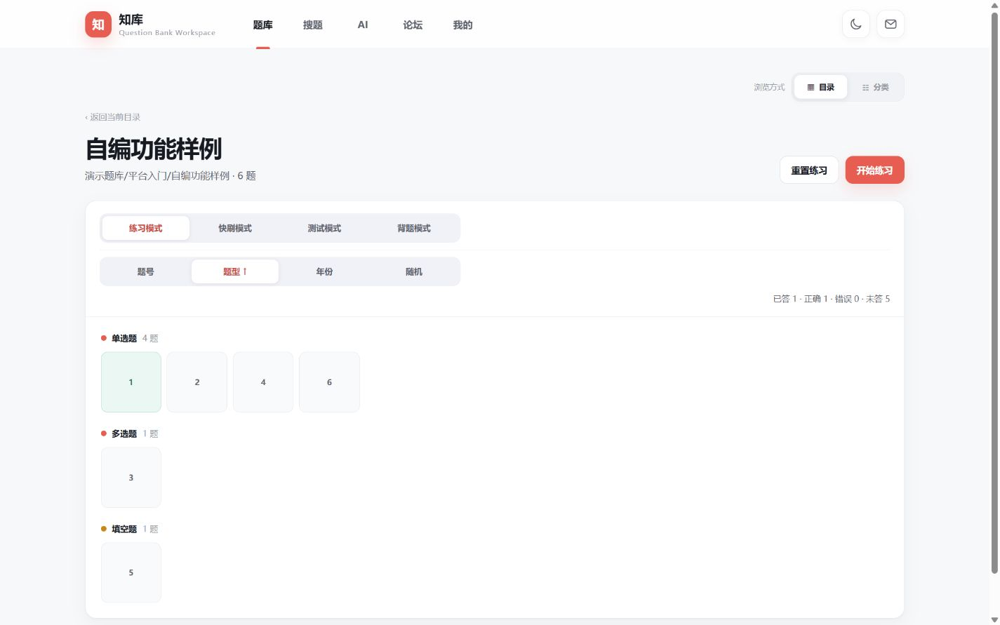
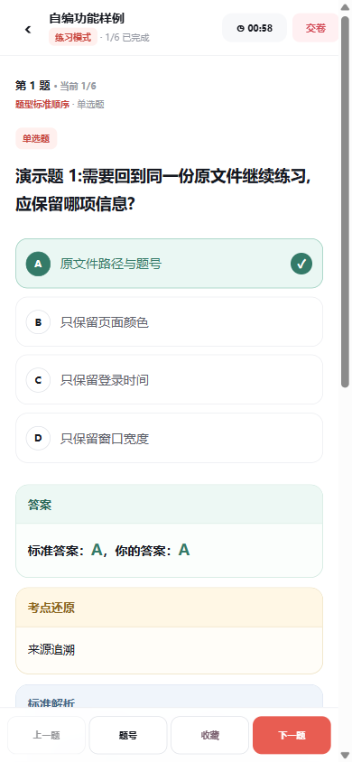
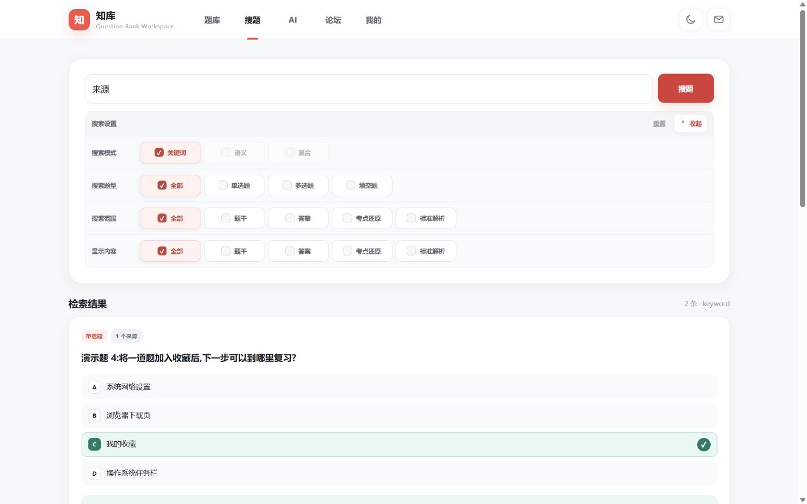

# 项目展示与复核

本页介绍医学题库平台的代表工作和可重复体验路径。截图来自本仓库真实前端、临时账号与六道自编操作样例，
不展示生产账号、私人题库或付费模型输出。

## 文件题集与学习模式

使用 `scripts/run_demo.py` 启动，创建临时账号后进入“演示题库 → 平台入门 → 自编功能样例”。
核对原题号、题型、四种模式与排序入口；开始后刷新页面，确认会话顺序与题号保持。

## 作答与复盘

在练习模式中选择并提交一题，查看标准答案与自己的答案；切换题目后返回，检查作答状态。
在测试模式中，显式交卷前不能获得答案与成绩。收藏后从个人入口回到原题。

## 检索与来源

关键词输入“来源”或“演示题”，核对结果与原题的对应关系。
语义与混合检索需要独立构建向量，AI 需要另配服务；未配置时保留真实禁用或不可用状态。

## 可核验的技术工作

| 问题 | 实现与证据入口 |
| --- | --- |
| 去重后仍需保留原文件答案差异 | `medical_app/builder.py`、`catalog.py` 及[数据架构](data-architecture.md) |
| 练习刷新、排序与草稿不能串题 | `practice.py`、`practice_api.py` 与相关测试 |
| AI 需要来源与账号隔离 | `ai.py`、`ai_api.py`；会话、引用及停止处理 |
| 本地演示不能触碰真实资料 | `scripts/run_demo.py` 与 `tests/test_demo.py` 的路径覆盖、临时清理验证 |

这些工作体现应用设计、数据建模与工程集成。模型、数据库与框架仍分别归属其上游，
题库规模记录不能替代准确性、并发或教学效果验证。

## 截图与验证边界

- 截图日期：2026-10-17；样例不包含真实医学试题，页面无私人数据。
- 浏览器检查目标：1440×900 与 390×844 的目录、练习和搜索路径。
- 运行健康、自动测试、浏览器交互与生产服务分别验证；本轮不操作生产服务。
- 账号在演示停止后清理，不提供可在生产环境复用的默认密码。
